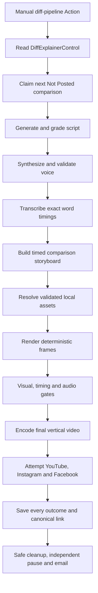

# Difference explainer pipeline plan

## Decision and isolation rule

Build the difference-video experiment on branch `diff-pipeline` without modifying the active Dreams production path. The branch starts from the tested `main` commit so it can reuse stable infrastructure, but the new implementation lives under its own source, asset, test and workflow paths.

Do not copy the whole production implementation and delete pieces until it happens to work. That creates a large fork whose bugs and fixes drift from `main`. Do not refactor `src/automation` to make the experiment fit. Build the comparison-specific domain, content planning, asset system, orchestration and renderer from scratch. Reuse existing low-level behavior only through narrow adapters where the existing interface already fits.

The deletion test defines isolation: deleting `src/difference-pipeline`, `assets/difference-pipeline`, its tests and its workflow must remove the new product without changing the existing reel pipeline.

The existing `.github/workflows/reel-automation.yml`, `src/automation`, Sheet queue, `AutomationControl` state and production schedule remain untouched. During branch development the new workflow is manual-only. Scheduled GitHub workflows run from the default branch, so a schedule is considered only after the isolated workflow is proven and deliberately merged.

## Product target

Produce short vertical explainers in the visual grammar of the supplied reference:

- one simple technical comparison per video;
- a fixed light brand layout;
- Concept A and Concept B remain visually anchored;
- a recurring illustrated mascot changes pose to guide attention;
- central semantic phrases change with narration;
- exact word captions remain in a platform-safe zone;
- small purposeful motion and sound cues keep the video lively;
- no presenter video, lip-sync, arbitrary web scraping or manual editing in a healthy run.

The initial product supports only the **difference/comparison** format. It does not attempt process, list, myth/fact or general custom-animation formats. Those can become additional storyboard adapters only after the first format succeeds across varied topics.

Recommended duration is 25–40 seconds and 65–105 spoken words. This format should end when the distinction is understood instead of stretching every idea to 60 seconds.

## End-to-end workflow



### 1. Control gate and intake

Use a separate Sheet tab, recommended `DifferenceExplainers`, and a separate control tab, recommended `DiffExplainerControl`. The new control flag cannot pause or resume the core Dreams workflow.

Initial task fields:

| Field | Rule |
| --- | --- |
| Concept A | Required, 1–80 characters |
| Concept B | Required, 1–80 characters |
| Context | Optional trusted notes or example |
| Narration | Optional; when supplied, preserve exactly |
| Status | Only `Not Posted` is eligible |
| Platform links | Existing links prohibit automatic republishing |
| Progress and remarks | Persist stages, grades, provider IDs, links and cleanup |

Claim one row at a time. Use stable task/job IDs, detect stale `Processing`, never resume an uncertain upload and pause only `DiffExplainerControl` after a terminal incident.

### 2. Script planning

The script module exposes one deep interface:

```ts
planComparison(task: DifferenceTask): Promise<ComparisonScript>
```

Its implementation owns prompting, schema validation, grading and one repair attempt. The caller receives a valid comparison script or a typed failure.

The planned sequence is:

1. Hook: name both concepts and ask the difference immediately.
2. Concept A: one plain-English definition and visible example.
3. Concept B: one plain-English definition and visible example.
4. Relationship: show how they interact or why people confuse them.
5. Concrete scenario: use both correctly in one real situation.
6. Memory rule: finish with one compact distinction.

The JSON result contains title, exact narration, shared social caption, the two concept cards and five or six ordered semantic beats. Beat text must partition the exact narration. Each beat declares its headline, attention target, mascot intent and meaningful visual action. It does not contain HTML or executable animation code.

Deterministic content checks enforce word count, exact beat coverage, distinct definitions, presence of a concrete example, no introduction/outro filler, no stage directions and no unsupported calls to action. A semantic quality pass grades clarity, factual consistency with supplied context, usefulness of the example and strength of the final memory rule. Failure receives one repair attempt; there is no provider fallback.

### 3. Voice and pacing

Reuse the existing `voicebox/synthesize.py`, `assets/Base-audio.mp3`, the reviewed transcript and the media command/audio inspection utilities. Do not reuse `src/automation/voice` directly because its interface and implementation force narration into a 55–65 second target.

The new voice adapter will:

1. synthesize the exact approved narration;
2. validate decodability, duration, sample rate, audible energy and clipping;
3. normalize near -16 LUFS with a true-peak ceiling near -1.5 dB;
4. accept the natural 25–40 second result instead of stretching it to one minute;
5. regenerate once when synthesis or audio validation fails.

No new voice identity, local inference server, generated-output cache or provider fallback is introduced.

### 4. Actual word timing

Use AssemblyAI word timing through a new adapter that returns the difference-pipeline domain types. Reuse the existing alignment algorithm where its interface can be cleanly adapted; do not change the current caption module.

Alignment replaces transcription spelling with intended script spelling only when the spoken sequence remains sufficiently close. Missing speech, invalid overlap, unexplained duration or excessive word error rejects the job. Timed beats are derived from actual speech, and every visual cue references a beat time or word anchor.

### 5. Timed storyboard

The storyboard module has one external interface:

```ts
direct(script: ComparisonScript, timing: WordTiming): Promise<Storyboard>
```

It converts semantic beats into a constrained visual plan. A typical cue contains:

```ts
{
  layout: "comparison",
  headline: "A browser opens and displays websites",
  attention: "left",
  mascot: { pose: "point-left", entrance: "slide", emphasis: "nod" },
  cards: {
    left: { state: "highlighted", action: "reveal-example" },
    right: { state: "dimmed", action: "hold" }
  },
  anchors: [{ word: "browser", action: "pulse-left-label" }],
  sound: "soft-pop"
}
```

The storyboard may choose among approved poses, actions and transition IDs. It cannot invent screen geometry, asset paths, CSS, remote URLs or arbitrary code. Validation ensures chronological anchors, full narration coverage, reasonable dwell time and regular meaningful change.

### 6. Mascot and movement design

Use one pre-approved mascot identity with 12–16 transparent poses rather than generating a new character per job. Recommended initial poses:

- neutral;
- confused;
- thinking;
- point-left;
- point-right;
- explain-left;
- explain-right;
- compare-both;
- warning;
- idea;
- result;
- celebrate.

Each pose is a high-resolution transparent PNG or WebP cropped to a common canvas and anchor point. A manifest records pose ID, gaze direction, attention target, safe scale and content hash.

Movement is deterministic and inexpensive:

- slide or fade into the reserved mascot zone;
- small position/scale easing while the pose is held;
- crossfade between compatible poses;
- subtle emphasis bounce or nod at a word anchor;
- at most two pose changes inside one beat;
- no skeletal animation, lip-sync or independently running clocks;
- never cover concept cards, semantic text or word captions.

This matches the reference: liveliness comes from pose choice, attention direction and timely changes, not full character animation.

### 7. Reference-image policy and validation

Reference images have five independent validity dimensions. A file is usable only when all five pass.

| Dimension | Required evidence |
| --- | --- |
| Technical | Real decoded image, allowed MIME, minimum dimensions, expected aspect/canvas, bounded size, no corrupt frames |
| Safety | Local file only, no embedded script/remote dependency, sanitized SVG or rasterized input, controlled path |
| Visual | Subject not clipped, readable at phone size, sufficient contrast, no unintended background for transparent poses |
| Semantic | Manifest label and intended concept match what the asset depicts; no misleading example |
| Provenance | Creator/source, license or ownership, permitted social use and immutable SHA-256 recorded |

Create `assets/difference-pipeline/asset-manifest.json`. Every asset referenced by a storyboard must appear in the manifest and match its recorded hash. Startup validates the complete pack before claiming a task.

Static mascot and brand assets receive one setup-time visual approval, then hashes lock them. Healthy production has no per-video manual approval.

For the first implementation, topic visuals should be built from approved icons, text, shapes and simple local SVG diagrams. Do not scrape Google Images, websites or social posts. Do not automatically download logos or screenshots. A screenshot may be added only as an explicitly curated asset with provenance and a manifest entry.

If dynamic AI illustrations are introduced later, they enter through a separate image-generation adapter and must pass the same technical, semantic and visual checks before rendering. They are not part of the first traceable implementation.

### 8. Layout and rendering

Build the new renderer from scratch around one typed comparison template. Reuse Playwright, Sharp, FFmpeg and deterministic explicit-time frame seeking from the existing implementation, without changing the existing renderer.

The template reserves stable zones:

- brand marker/watermark;
- two concept cards;
- central semantic phrase;
- mascot stage;
- exact word-caption safe area;
- platform UI exclusion margins.

AI controls content and approved cue IDs. Code owns positions, typography, palette, clipping, transitions and timing execution. Use 1080×1920 output. Begin with 30 fps while benchmarking because pose/template motion receives little visible benefit from 60 fps and 30 fps halves frame-render pressure. A 60 fps export remains an explicit later decision based on measured quality and Actions runtime; it is not inherited automatically from the core workflow.

Meaningful change should occur about every 1–2 seconds, a pose or composition change every 3–5 seconds and a major beat every 5–8 seconds. Completed explanations hold long enough to read. Decorative particles and continuous motion are excluded.

### 9. Captions, music and sound effects

Render two text layers:

- a short semantic headline that supports the current explanation;
- exact phrase-aware captions derived from the spoken words.

The mascot and cards cannot enter the caption safe area. Highlight the current technical term without turning every word into visual noise.

Reuse the existing BGM asset only after checking that its style fits the new light explainer brand. Add a small local, licensed sound pack with manifest entries such as `soft-pop`, `click`, `whoosh` and `payoff`. The storyboard chooses only these IDs. Limit effects to meaningful transitions. Duck music/effects under voice and verify integrated loudness, true peak, audible speech and absence of long accidental silence.

### 10. Automated quality gates

Before publishing, the pipeline verifies:

- content and semantic quality grades meet their thresholds;
- every narration word and beat has valid timing;
- every asset is manifest-approved and hash-valid;
- mascot identity/canvas/anchor is consistent;
- no card, headline, mascot or caption collision;
- no text overflow, blank opening or frozen section;
- meaningful visual changes occur at expected cues;
- contrast and minimum text size remain phone-readable;
- audio duration matches video and voice dominates the mix;
- final file is decodable H.264/AAC at 1080×1920;
- the cover/title remains readable in sampled platform crops.

Use representative fixtures for at least browser/search engine, website/webpage and RAM/storage. Store contact sheets and quality measurements as Actions artifacts for failed test runs, not as permanent production media.

### 11. Publishing and finalization

Reuse the existing platform publishing implementation through a difference-domain adapter after local rendering is proven. Use the same three-platform completion rule and provider verification, but separate all state:

- distinct Sheet/control tabs;
- distinct job IDs and progress schema discriminator;
- Supabase keys prefixed with `difference-explainers/`;
- email subjects prefixed `Dreams Difference`;
- failures pause only the difference pipeline;
- successful remote posts are never deleted;
- existing links block automatic republishing;
- partial outcomes retain every known provider ID/link.

The branch workflow defaults to render-only and stores a temporary artifact for inspection. Live publishing becomes a deliberate workflow input only after credentials are repaired and offline/render validation passes. When later merged, the new workflow remains `workflow_dispatch` only until a successful live end-to-end run is recorded.

## Source structure

```text
src/
  automation/                         # existing production; untouched
  difference-pipeline/
    domain.ts                         # task, script, timing, storyboard, outcomes
    config.ts                         # DIFF_* configuration and validation
    main.ts                           # new entry point
    workflow/index.ts                 # serial lifecycle and finalization
    sheets/index.ts                   # separate queue/control tabs
    content/index.ts                  # comparison script and quality
    voice/index.ts                    # short natural-duration Voicebox adapter
    captions/index.ts                 # AssemblyAI and timing adapter
    storyboard/index.ts               # constrained timed visual plan
    assets/index.ts                   # manifest and image validation
    rendering/index.ts                # fixed layout and frame renderer
    publishing/index.ts               # adapter to proven platform transport
    operations/                       # scoped config, logging and notification

assets/difference-pipeline/
  brand.json
  asset-manifest.json
  mascot/
  icons/
  sounds/

tests/difference-pipeline/
.github/workflows/difference-pipeline.yml
```

## Reuse matrix

| Capability | Decision | Reason |
| --- | --- | --- |
| Existing workflow and Sheet module | New implementation | State and pause controls must be independent |
| Existing content planner | New implementation | Comparison scripts have a different duration and typed structure |
| Voicebox Python engine/reference voice | Reuse | Same approved voice identity and CPU engine |
| Existing voice TypeScript module | Do not import directly | It enforces the core 55–65 second policy |
| HTTP retry/poll semantics | Reuse or move later behind an adapter | Proven bounded behavior, no product policy |
| Media probing/audio assertions | Reuse through an adapter | Proven low-level capability |
| Caption alignment algorithm | Reuse through mapped types | Actual-word safety applies to both products |
| Existing custom-code renderer | New fixed renderer using proven techniques | Current visual contract conflicts with the reference style |
| Playwright/Sharp/FFmpeg | Reuse dependencies | Appropriate deterministic rendering toolchain |
| Platform publisher | Reuse through mapped types | Transport and verification policies are already tested |
| Email transport | Reuse transport, new message format | Same credentials; separate incident identity |
| Workspace implementation | Reuse with a distinct prefix | Bounded job cleanup already works |
| Reel composer UI and legacy modules | Do not use | Healthy production must remain headless and isolated |

Do not extract a new shared package before the second real consumer proves the exact seam. Initially, adapters may contain a small amount of duplicated mapping. After both pipelines pass independently, shared low-level code can be moved in a separate refactor with characterization tests for both callers.

## Configuration isolation

New non-secret settings use `DIFF_` names, including:

- `DIFF_SHEET_TAB=DifferenceExplainers`;
- `DIFF_CONTROL_TAB=DiffExplainerControl`;
- `DIFF_SUPABASE_PREFIX=difference-explainers`;
- `DIFF_TARGET_MIN_SECONDS=25`;
- `DIFF_TARGET_MAX_SECONDS=40`;
- `DIFF_RENDER_FPS=30`;
- `DIFF_PUBLISH_ENABLED=false` during branch validation.

Provider credentials may be shared because they represent the same accounts, but state, storage keys and control flags are not shared. The known Gmail, YouTube refresh-token and Supabase connectivity blockers must be corrected before a publishing-enabled run. Render-only development can continue without changing those remote systems.

## Implementation phases and gates

### Phase 0 — Preserve the core

- Pin the branch base commit and assert no diff under `src/automation` or `.github/workflows/reel-automation.yml`.
- Add a CI guard that fails if the experiment changes protected core paths.
- Add the isolated directories, types and manual workflow skeleton.

### Phase 1 — Traceable local reel

- Add a temporary approved mascot fixture pack and manifest.
- Implement manifest/asset validators.
- Implement fixed storyboard fixture and comparison renderer.
- Render a complete synthetic-audio browser/search-engine reel locally.
- Verify geometry, captions, movement, media format and cleanup.

### Phase 2 — Script, voice and timing

- Implement schema-bound comparison planning and quality grading.
- Add the short-duration Voicebox adapter.
- Add AssemblyAI timing and alignment adapter.
- Drive the same renderer from real timed output in an Actions render-only job.

### Phase 3 — Queue and operations

- Add separate Sheet intake/control/progress.
- Add cancellation, failure finalization, email format and cleanup.
- Test empty, invalid, failed, cancelled, interrupted and partial states without provider writes.

### Phase 4 — Publishing adapter

- Map the new domain to the existing tested publisher.
- Verify separate staging prefixes and publication journal ownership.
- Run read-only provider/configuration checks.
- Enable one explicitly requested live task, inspect all links and record timings.

### Phase 5 — Optional main integration

- Keep the original production workflow unchanged.
- Merge only the isolated source/assets/tests/manual workflow after review.
- Leave the difference workflow manual until its live result is accepted.
- Add an independent schedule later only if runtime, quota and content quality are acceptable.

## Completion criteria

The first version is complete only when:

1. the protected core diff guard passes;
2. three representative comparison fixtures render without collision or blank/frozen periods;
3. one full Voicebox/AssemblyAI run produces naturally timed output;
4. all assets have valid provenance and matching hashes;
5. render-only Actions succeeds within the measured free-tier budget;
6. Sheet/pause/finalization behavior is isolated from the original pipeline;
7. publishing cannot run accidentally while its flag is false;
8. one authorized live job returns verified canonical links from all three platforms;
9. the result and limitations are recorded before any schedule is enabled.

## Current conclusion

Use `main` as the stable foundation, not as source material to tear apart. Build the new product-specific modules from scratch inside `difference-pipeline`, and reuse only capabilities whose existing interfaces already match. The most valuable reuse is the voice engine, actual-word alignment logic, media tooling, workspace safety and platform transport. The content model, duration policy, mascot assets, image validation, storyboard, renderer, Sheet state and control plane should be independent.

This produces the simplest safe experiment: one comparison format, one mascot, one deterministic layout, one voice and one isolated queue. It can become lively through timing, pose changes, card emphasis and sound cues without inheriting the complexity of unrestricted generated animation.
