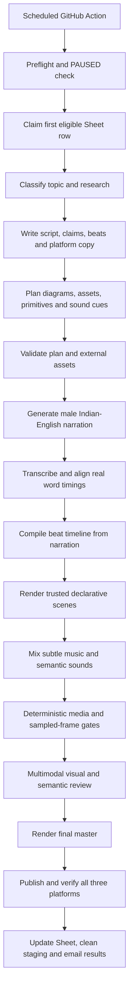

# Main Visual Pipeline Redesign

## Goal

Turn each Google Sheets topic into one authentic, technically accurate short video with the visual language of a clean hand-drawn engineering diagram. The system remains fully automated from intake through verified publication on YouTube Shorts, Instagram Reels, and Facebook Reels.

The target is a 1080×1920, 60 fps video lasting naturally between 35 and 65 seconds. The narration, diagrams, captions, motion, music, and sound cues must explain the same causal story. A job is complete only after all three platforms return a published/ready state with provider IDs and canonical links.

## Final product decisions

1. Replace the dark cyan/magenta/glow identity with a white diagram canvas.
2. Support engineering questions, X-vs-Y comparisons, interview questions, and technical scenarios. Infer the format from the topic unless the Sheet supplies `Type`.
3. Generate typed declarative visual plans. Trusted TypeScript renders every pixel.
4. Let AI propose a declarative primitive when the trusted library lacks a capability. Never execute generated JavaScript or TypeScript.
5. Use diagrams by default. Use an external image only when a real product, interface, or artifact materially improves the explanation.
6. Show captions as phrase-aware chunks of 2–5 words, with black text and the currently spoken word in blue. Move a caption only when it would cover the active diagram.
7. Use the calm Indian-English male voice prepared for this project.
8. Accept `Topic` as the only required Sheet input. `Type`, `Context`, `Audience`, and `Source URLs` are optional.
9. Let the final narration determine duration. Do not pad the script or speed up the voice.
10. Render one high-quality 1080×1920, 60 fps master for all platforms.
11. Use Gemini knowledge for stable fundamentals and official/primary documentation for version-sensitive claims. If research cannot be obtained, Gemini may produce the best available answer and the report must record that research evidence was unavailable.
12. Keep the voice dominant. Add very quiet background music and rare, soft interface sounds only when a meaningful event occurs.
13. Start immediately with the explanation. Do not add an intro, cover card, logo, watermark, greeting, or engagement bait.
14. Use adaptive story structures based on detected content type.
15. Use a fixed semantic palette: white canvas, black structure, blue active/current, green safe/success/new, yellow warning/question, and red failure/offline/destructive.
16. Prefer official images. Google-discovered images are allowed only after source, rights, relevance, resolution, crop, and semantic validation.
17. Use a newly generated primitive in its current job after validation. Preserve it as a review artifact. Email a button that opens its Sheet review row; only a checked `Promote` field allows a later job to add it to the trusted reusable library.
18. Allow one targeted repair for each failed creative stage. A second failure stops the pipeline, records the exact failure, pauses future work, cleans safe temporary data, and emails the user.
19. Use purposeful motion tied to narration: draw-on, slide, pulse, transfer, and state changes. Settled objects remain quiet.
20. Gate publishing with deterministic checks and a multimodal AI review of sampled frames.
21. Store source links in the job record. Do not place citations on the video.
22. Show one primary idea per beat and no more than 5–7 meaningful visible elements.
23. Let real word timestamps control captions, beats, animation timing, and selective audio cues.
24. Publish the same master video to all three platforms while generating platform-specific descriptions.

## End-to-end workflow

Every creative stage returns typed data and evidence. No stage passes free-form text directly into the renderer.

## Story planner

The planner first classifies the Sheet row into one of four structures:

| Type       | Beat structure                                                              |
| ---------- | --------------------------------------------------------------------------- |
| Question   | Problem → naive understanding → failure → correct model                     |
| Comparison | Shared purpose → essential difference → concrete example → practical choice |
| Interview  | Exact prompt → reasoning → scalable answer → tradeoff                       |
| Scenario   | Initial state → triggering event → consequence → resolution                 |

The opening sentence states the exact confusion. The script uses natural Indian English, one continuous example, short varied sentences, and concrete technical terms. It ends when the distinction or result is clear. Generic introductions, dramatic hooks, calls for likes, stage directions, and padded conclusions fail validation.

The content result should separate:

- narration;
- factual claims and source links;
- timed semantic beats;
- visual intents;
- platform-specific titles/descriptions;
- confidence and research mode (`primary-evidence` or `gemini-best-effort`).

## Typed visual language

The implemented version 2 contract is a reel-wide `VisualStory`, documented in [CONTINUOUS_VISUAL_SYSTEM.md](CONTINUOUS_VISUAL_SYSTEM.md). Its `world` persists for the complete reel, its global `timeline` mutates that world at narration anchors, and its restrained `camera` track reframes the same world. Content beats organize narration but never reset the visual canvas.

Replace per-scene generated code with the versioned `VisualStory` schema. Its vocabulary covers:

- text labels, code cards, tables, database cylinders, files, queues, servers, clients, browsers, APIs, locks, warnings, status chips, arrows, paths, packets, counters, and highlights;
- layout groups such as rows, columns, stacks, split comparisons, pipelines, and callout regions;
- operations such as create, reveal, draw, transfer, mutate, compare, annotate, focus, dim, remove, and settle;
- narration anchors based on word IDs rather than guessed seconds;
- semantic colors rather than arbitrary color values.

Each object keeps a stable ID and stable resting position across beats. Scene transitions change state in place whenever possible. A new beat may remove irrelevant objects, but it cannot move persistent objects without an explicit layout transition.

### Self-extending primitives

When the planner cannot express a visual:

1. It emits `missingCapability` and a declarative primitive proposal.
2. The proposal may compose only approved shapes, paths, text slots, layout constraints, states, and animation operations.
3. Schema, geometry, complexity, timing, contrast, and semantic checks run.
4. One targeted AI repair is allowed.
5. The validated primitive renders in an isolated preview and then in the current job.
6. The primitive specification, preview, validation report, and usage context are saved as an Actions artifact and recorded in a `PrimitiveReview` Sheet tab.
7. The completion email contains a button linking to that review row.
8. A future scheduled run imports it into the reusable registry only when `Promote` is checked. The importer revalidates it before committing the promoted registry artifact.

This gives AI a way to handle unseen concepts without granting it an executable-code path or silently changing later videos.

## Visual composition

Use a white canvas with a narrow yellow and black accent at the top. The body contains only the diagram, necessary images, and captions. Black carries structure and primary text. Blue marks the current narrated object or word. Green, yellow, and red appear only for their fixed meanings.

The layout engine owns safe areas and collision avoidance. It calculates text size, wrapping, connector routes, image crops, and caption placement before rendering. It rejects clipped edges, overlapping labels, connector crossings through unrelated objects, unreadable text, captions covering active objects, and frames exceeding the 5–7 element budget.

Motion must explain a change. Requests travel along paths, rows appear when inserted, locks close when acquired, failed nodes turn red, and selected alternatives receive a blue focus. Ambient bobbing, decorative particles, arbitrary zooms, and continuous camera movement are prohibited.

## External image acquisition

The asset stage receives an explicit `AssetIntent` containing the subject, why it is needed, required visible features, crop target, and source preference.

The search order is:

1. official documentation or product media;
2. official public repositories or press assets;
3. Google-discovered sources with a valid original page and acceptable reuse terms.

Each candidate must pass URL and MIME validation, minimum-resolution checks, duplicate detection, safe decoding, source attribution capture, crop simulation, and a multimodal relevance check against `AssetIntent`. One new search is permitted after rejection. A second failure stops the job; the renderer cannot replace the missing image with a generic placeholder.

## Narration, captions, and sound

The voice stage uses the approved calm male Indian-English reference. It synthesizes one natural pass unless the engine itself requires internal segmentation. The resulting audio must pass duration, silence, clipping, sample-rate, and true-peak checks.

Transcription of the produced audio is the timing authority. Alignment maps actual words to the intended narration and rejects missing or materially changed speech. Caption phrases use grammatical boundaries and contain 2–5 words. Captions stay in a lower safe zone unless collision analysis chooses another reserved caption lane. The active word is blue; the other words are black.

Background music stays far below speech and ducks further during dense explanations. Sound cues are selected from a small owned library by semantic event, such as a soft click for selection, a short transfer sound for packet movement, or a muted warning for failure. A cooldown and total-count limit prevent repetitive effects. Final loudness, true peak, speech intelligibility, and silence checks run on the mixed master.

## Quality gates and repair

Deterministic gates check:

- schema validity and referential integrity;
- factual-claim/source bookkeeping;
- safe areas, collisions, clipping, contrast, font size, and element density;
- stable object positions and valid connector routes;
- caption length, timing, readability, and diagram avoidance;
- meaningful visual change during each beat;
- audio duration, silence, clipping, loudness, and word alignment;
- 1080×1920 dimensions, 60 fps, codecs, duration, and final file integrity.

The renderer samples the opening, closing, narration anchors, state changes, and regular intervals. A multimodal critic receives the script intent and sampled frames and grades technical meaning, sequence clarity, visual relevance, cleanliness, consistency, and caption readability. It returns structured defects tied to beats and object IDs.

The repair controller modifies only the smallest failed unit. It allows the initial attempt and one repair for that unit. A repeated failure stops the job. There is no lower-quality fallback and no automatic later retry.

## Module design

Keep `src/automation/workflow`, publishing, workspace cleanup, pause control, and provider verification as the stable operational shell. Change the creative modules behind their interfaces.

| Module            | Responsibility                                                                                          |
| ----------------- | ------------------------------------------------------------------------------------------------------- |
| `intake`          | Parse required `Topic` and optional `Type`, `Context`, `Audience`, `Source URLs`; infer omitted fields. |
| `research`        | Resolve source URLs, collect official evidence when needed, and return source links plus research mode. |
| `content`         | Classify format and produce the factual story, narration, claims, beats, and platform copy.             |
| `visual-planning` | Convert beats into typed objects, states, layouts, transitions, asset intents, and sound intents.       |
| `primitives`      | Own trusted primitives, validate proposed declarative extensions, and handle promotion records.         |
| `assets`          | Search, download, validate, crop, attribute, and cache only within the current job.                     |
| `voice`           | Produce and validate the approved narration voice.                                                      |
| `captions`        | Transcribe, align, phrase, and place captions from actual audio timing.                                 |
| `timeline`        | Resolve word anchors into beat, motion, caption, and sound timing.                                      |
| `renderer`        | Render the white diagram system through trusted TypeScript components.                                  |
| `audio-mix`       | Mix narration, owned background music, and rate-limited semantic cues.                                  |
| `quality`         | Run deterministic media/visual checks and the multimodal critic.                                        |
| `publishing`      | Publish the shared master with per-platform metadata and verify IDs/links.                              |
| `operations`      | Persist progress, pause on failure, clean temporary data, and email outcomes/review links.              |

Public module entry points should accept and return domain types. Provider SDKs, prompts, browser rendering, FFmpeg commands, and storage details remain private implementation details.

## Domain changes

Add discriminated, versioned contracts for:

- `TopicBrief` and `DetectedContentType`;
- `ResearchPacket`, `Claim`, `SourceLink`, and `ResearchMode`;
- `StoryPlan`, `SemanticBeat`, and per-platform `PublicationCopy`;
- `VisualPlan`, `VisualObject`, `VisualState`, `LayoutConstraint`, `Transition`, and `WordAnchor`;
- `PrimitiveSpec`, `PrimitiveValidation`, and `PrimitiveReview`;
- `AssetIntent`, `AssetCandidate`, and `ValidatedAsset`;
- `SoundIntent` and `AudioMixReport`;
- `DeterministicQualityReport`, `VisualCriticReport`, and `RepairRecord`.

Do not use optional bags for stage-critical data. A validated stage output should be a distinct type so later stages cannot consume an unvalidated plan, asset, primitive, or render.

## Sheet and email changes

Keep the current queue and control behavior. Add optional input headers without breaking existing rows. Store compact job summaries in the main task row and larger structured records in dedicated tabs or Actions artifacts.

Add a `PrimitiveReview` tab with job ID, primitive ID, capability, artifact URL, preview URL, validation status, `Promote` checkbox, promotion status, and timestamps. The email approval button opens the exact Sheet review range. Approval is data only; the next scheduled Actions run performs the promotion after revalidation, preserving the no-server and free-tier design.

Failure email must identify the stage, failed unit, initial defect, repair result, source mode, cleanup outcome, pause state, Actions link, Sheet link, and any partial publication links. Completion email includes all verified links and any primitive awaiting review.

## Operational state machine

Keep a task `Processing` while creative work or publication verification is active. Record the last completed stage after each durable transition. `Completed` means all three platforms succeeded and returned canonical links. Any creative or operational failure pauses future scheduled work. Partial publication still attempts the remaining platforms before pausing and reporting every outcome.

Cancellation stops new work, allows safe in-flight shutdown where possible, records the last completed stage, removes local and safe staging data, and emails what was cleared. Empty queues exit successfully without pausing or sending a failure email.

## Implementation sequence

1. **Foundation:** merge the existing `codex/main-human-quality` improvements, add the new domain contracts, optional Sheet fields, research records, and stage persistence without changing rendered output.
2. **Declarative renderer:** implement the palette, typography, safe areas, layout solver, primitive registry, visual-plan interpreter, stable object lifecycle, and deterministic frame checks.
3. **Adaptive planning:** add topic classification, four story structures, claim/source packets, visual planning, platform-specific copy, and typed prompt validation.
4. **Timing and audio:** make final word timings authoritative, implement phrase captions, collision-aware lanes, subtle owned music, semantic cue rules, and final mix gates.
5. **Assets and extensions:** implement official-first search, candidate validation, isolated primitive proposals, review artifacts, Sheet approval, and revalidated promotion.
6. **AI quality gate:** add sampled-frame selection, structured multimodal criticism, targeted repair, and stop/pause reporting.
7. **Integration:** run local fixture renders, mocked end-to-end jobs, and one controlled GitHub Actions production run before enabling the twice-daily schedule.

Each phase should be a reviewable commit on a feature branch. `main` receives only a phase whose type checks, deterministic tests, smoke tests, fixture renders, and failure-path tests pass.

## Test strategy

Use representative fixtures for a question, comparison, interview prompt, and scenario. At least one fixture must require a real external image and one must require a new declarative primitive.

Tests should prove:

- existing Sheet rows remain valid;
- classification and override behavior are deterministic at the boundary;
- invalid claims, plans, primitives, images, geometry, captions, and audio cannot reach publishing;
- word anchors remain aligned after real transcription;
- persistent objects do not jump across beat boundaries;
- repair affects only the failed unit and stops after one retry;
- primitive approval is never inferred from email delivery and requires the Sheet checkbox;
- publication attempts all three targets and records every result;
- failure pauses future work, cleans safe staging, and emails a complete incident report.

Fixture renders should also produce a contact sheet of sampled frames and a low-resolution preview artifact for review. The production master remains 1080×1920 at 60 fps.

## Acceptance criteria

The redesign is ready for production when all four content types produce readable, technically coherent videos in the new white diagram language; no generated executable code reaches the browser; captions follow actual speech and avoid diagrams; visuals remain within safe areas with stable object identity; external images and new primitives pass their complete validation paths; audio is clear and restrained; the automated critic and one-repair rule behave predictably; and the existing all-platform publication, Sheet, cleanup, pause, and email guarantees still pass end to end.
