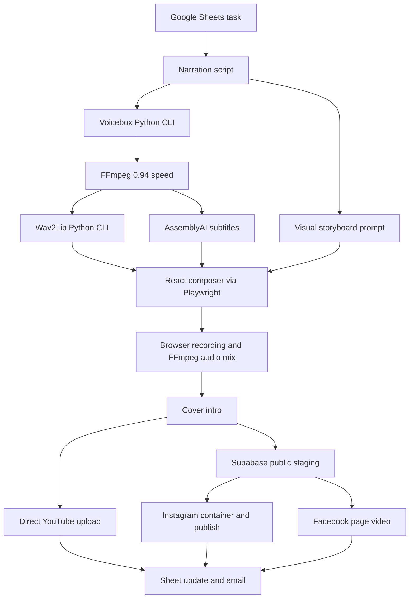

# Historical project map

> This describes the pre-redesign pipeline and is retained only for migration context. The active system is documented in [IMPLEMENTATION.md](IMPLEMENTATION.md) and [MAIN_VISUAL_PIPELINE_PLAN.md](MAIN_VISUAL_PIPELINE_PLAN.md).

## Product and active execution path

Dreams turns an idea from Google Sheets into a narrated educational video with a talking head, animated technical visuals, captions, cover, background music, and social publishing. The primary entry point is `src/main_automation.js`; it invokes `main()` immediately when loaded. It is a batch script, not an HTTP server.

## What actually happens

1. `sheetsService.getNextTask()` reads `Sheet1!A:Z`, interprets headers, and selects the first eligible row. Eligible statuses include `not posted`, `not_posted`, blank, `pending`, and exactly `error`. An empty queue throws.
2. The runner writes `Processing`. Reading and updating are separate requests, so this is not an atomic claim.
3. `scriptService.generateScriptForTask({ idea })` generates narration. The task description and existing scripts column are not passed into this main-path call. Prompted length is 140–160 words; actual word count is logged, not enforced.
4. `voiceboxService` spawns `python` with `voicebox/main.py`, reference audio, text, and delivery instructions. Voicebox defaults to Qwen3-TTS 1.7B; absent reference text triggers Whisper transcription. Voice prompts are cached. The runner subsequently applies FFmpeg `atempo=0.94`.
5. `wav2lipService.syncLip()` spawns `wav2lip/inference.py` using the GAN checkpoint. A root `Base-vedio.npy` can supply cached face boxes. Actual spawned resize factor is 1, despite the debug command showing 2. `USE_PREMIUM_WAV2LIP=true` requests GFPGAN when its weights exist.
6. `utils/subtitles.js` uploads audio to AssemblyAI, requests transcription, polls, exports SRT, and saves it in `subtitles/`. The runner also copies it to root `subtitles.srt`.
7. `scriptService.generateVisualPromptForTask()` creates a short storyboard with Gemini. Unlike narration, this function has no Groq fallback.
8. Inline `runCompositor()` opens headed Chromium at hardcoded `http://localhost:3000`, enters an API key, uploads video/SRT, fills a textarea, and navigates through text-based button selectors.
9. Composer generates HTML and a timed layout schedule. `ReelPlayer` renders an iframe, synchronizes it with video time, overlays captions, and records browser display capture using `MediaRecorder`, with cropping when supported.
10. The download is saved under an MP4 filename even if its actual container is WebM. FFmpeg re-encodes it and uses audio from `merged_output.mp4`, delayed by 400 ms. Optional BGM loops at volume 0.2.
11. `prependCoverIntro()` requires `assets/cover.png`, inserts a default 0.5-second cover, and delays audio accordingly.
12. Caption generation uses Groq with a static fallback. Supabase stages the file for Meta. YouTube uploads independently; Meta uploads are skipped if staging fails.
13. Any nonempty platform link counts as success. One platform success marks the row `Posted`; there is no durable per-platform retry state. Email failure is logged without failing the success path.
14. Staging deletion is commented out on both success and failure. The outer catch writes `Error: <message>` and sends email, but does not explicitly set a failing process exit code.

## Code ownership today

| Location | Current role | Relationship to main path |
| --- | --- | --- |
| `src/main_automation.js` | Orchestration, UI driving, export processing, cover, error handling | Active and mixes several responsibilities |
| `src/services/scriptService.js` | Narration and storyboard prompt generation | Active; structured results plus compatibility string exports |
| `src/services/voiceboxService.js` | Python CLI wrapper | Active |
| `src/services/wav2lipService.js` | Python CLI wrapper | Active |
| `src/services/sheetsService.js` | Task intake and output writes | Active |
| `src/services/socialMediaService.js` | OAuth, storage, captions, publishing | Active and combines unrelated concerns |
| `src/services/emailService.js` | Email content and transport | Active |
| `reel-composer/` | React 19, TypeScript, Vite 6 editor and recorder | Active through UI automation; also usable manually |
| `voicebox/backend/` | TTS/STT backends plus FastAPI/profile/history/studio features | CLI uses backend subset; full application features are separate |
| `wav2lip/` | PyTorch models, face detection, inference, restoration | Active Python implementation |
| `src/controllers/`, `src/routes/` | Older Express-style API workflow | No server bootstrap found in inspected source; not equivalent to main path |
| `src/services/audioService.js` | Empty export with directory side effect | Older callers still request removed functions |
| `imageService`, `videoProcessingService`, render/post makers | Alternate slide, video, and social paths | Mostly older/alternate paths; inspect callers before removal |
| `bin/`, `test/` | Ad hoc integration and diagnostic scripts | Not a unified automated test suite |
| `archive/`, `.github/workflows-archive/` | Historical workflows | Reference material |
| `bridge/content.json` | Historical interchange artifact | Not consumed by inspected main runner |

## Configuration and runtime

- Root JavaScript is CommonJS. Root `package.json` has no scripts and points `main` at a missing root `test_full_automation.js`; a similarly named script exists in `archive/`.
- Composer is an ESM package with `dev`, `build`, and `preview` scripts. Port defaults to 3000. The runner does not start it itself.
- Google Sheets expects `GOOGLE_SHEET_ID` and JSON service-account credentials in `GOOGLE_CREDENTIALS`. `.env.example` incorrectly describes those credentials as base64; code calls `JSON.parse()` directly.
- AI configuration includes Gemini keys, optional Groq, and required AssemblyAI for the main subtitle path. Source currently uses Gemini 2.5 Flash for narration and 2.5 Pro for storyboard generation. These are observed source settings, not externally verified provider availability.
- YouTube requires OAuth client credentials and refresh token. Its current upload is public. Instagram/Facebook use account/page IDs and access tokens. Main publishing functions use Graph v23.0; an older permalink helper uses v18.0.
- Supabase client is constructed at module load. Missing configuration can fail before the runner's catch is entered. A reachable public storage URL is needed by the current Meta paths.
- Python wrappers invoke `python`, not `python3`. FFmpeg must also exist on PATH for Python subprocesses; `ffmpeg-static` alone does not supply system `ffprobe`.
- `FORCE_CPU` is read by Wav2Lip inference. It should not be assumed to control every Voicebox backend.
- Composer stores its Gemini key/model preference in local storage. Vite can inline environment keys; this needs reconsideration if deployed beyond a trusted local environment.

## Execution environments

`.github/workflows/reel-automation.yml` schedules 06:00 UTC / 11:30 AM IST and permits manual dispatch. It installs Node 20, Python 3.10, system dependencies, models, and Chromium, starts composer, and runs the main script under Xvfb. Timeout is 340 minutes; artifacts include root MP4/SRT/log/screenshot files.

`daily-local-support.yml` targets branch `local-support` and `src/local-support/automation_logic.js`, which does not exist in this checkout. Its cron entries are commented out. Treat it as a distinct branch-specific workflow until its intended lifecycle is decided.

Docker is incomplete for the active path: its command targets missing root `main_automation.js`, does not install/start composer separately, and does not provide the same headed-display setup as the primary Actions workflow. The Python executable name also needs verification in that image.

## Artifacts and checked-out prerequisites

| Artifact | Producer or use |
| --- | --- |
| `assets/Base-audio.mp3` | Voice reference, present |
| `assets/Base-vedio.mp4` | Talking-head input; currently a Git LFS pointer |
| `assets/cover.png` | Required cover, present |
| `assets/Bgm.m4a` | Optional background music, present |
| `wav2lip/checkpoints/wav2lip_gan.pth` | Currently a Git LFS pointer |
| `wav2lip/face_detection/detection/sfd/s3fd.pth` | Currently a Git LFS pointer |
| `audio/cloned_voice_*.wav`, `audio/slowed_*.wav` | Generated narration |
| `merged_output.mp4`, `subtitles.srt`, `visual_prompt.txt` | Shared root intermediate artifacts |
| `FINAL_REEL_*.mp4`, `FINAL_REEL_COVERED_*.mp4` | Render and publish artifacts |
| `combined.log`, `error.log`, `error_screenshot_*.png` | Diagnostics |

Composer dependencies are not installed in this checkout. No credentialed run, model download, upload, deletion, or external publishing was performed during this assessment.

## Confirmed defects versus design risks

Confirmed source inconsistencies: base64 credential documentation, stale package/Docker entry points, legacy calls to empty audio exports, exact `error` eligibility versus generated `Error: ...` statuses, disabled staging deletion, and no explicit failure exit code in the main catch.

Design risks: concurrent runners can claim the same row; shared filenames can collide; a crash can leave `Processing`; a successful upload followed by a failed Sheet update can cause duplicates on a later retry; partial publication is reduced to `Posted`; generated HTML acceptance checks do not establish animation quality; screen capture depends on browser/display timing and UI labels. These need requirements and focused tests before selecting fixes.
